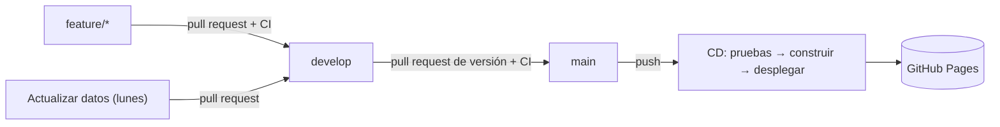

# Scraping de un artículo de Amazon con flujo DevOps

[](https://github.com/simoniudigital/scraping-amazon-devops/actions/workflows/ci.yml)
[](https://github.com/simoniudigital/scraping-amazon-devops/actions/workflows/deploy.yml)

**Tablero publicado:** https://simoniudigital.github.io/scraping-amazon-devops/

Proyecto del curso **Programación para Análisis de Datos** (IU Digital, grupo PREICA2602B020048).
Integrantes: Simón Castaño Ríos, Juan Pablo Gonzalez Gil y Luisa Fernanda Gómez Quiroz.
Docente: Andrés Felipe Palacio.

- **EA1:** extracción de la ficha de un producto de Amazon con BeautifulSoup, Selenium y Scrapy.
- **EA2:** control de versiones con Git y GitHub y un pipeline CI/CD con GitHub Actions que prueba
  el código y despliega un tablero web con los datos en GitHub Pages.

Artículo: *HSHFKLH – 3 piezas de arte de pared de lienzo de mujeres afroamericanas*
(ASIN [`B0D21SJ6BR`](https://www.amazon.com/dp/B0D21SJ6BR)).

## Estructura

```
scraping/
  comun.py                  URL, selectores CSS y funciones de limpieza compartidas
  scraper_beautifulsoup.py  Método 1: requests + BeautifulSoup
  scraper_selenium.py       Método 2: Selenium + Chrome
  scraper_scrapy.py         Método 3: Spider de Scrapy
  comparar_resultados.py    Tablas comparativas (CSV / Excel)
  generar_sitio.py          Tablero web estático (public/index.html)
tests/                      Pruebas con pytest y páginas de prueba sintéticas
data/                       Resultados de la extracción (JSON, CSV, captura)
notebooks/                  Cuaderno Jupyter de la EA1
docs/                       Informes entregados
.github/workflows/          Pipelines de GitHub Actions
```

## Uso local

```bash
python -m pip install -r requirements-dev.txt
pytest                                   # 18 pruebas, no necesitan internet
ruff check .                             # estilo de código
python scraping/scraper_beautifulsoup.py # extracción en vivo
python scraping/scraper_selenium.py      # agrega --headless para no abrir ventana
python scraping/scraper_scrapy.py
python scraping/comparar_resultados.py
python scraping/generar_sitio.py         # genera public/index.html
```

## Flujo de trabajo DevOps



### Ramas (Git Flow simplificado)

| Rama | Uso |
|---|---|
| `main` | Versión estable. Cada push despliega el tablero. Solo recibe cambios por pull request desde `develop`. |
| `develop` | Integración. Recibe las ramas `feature/*` por pull request. |
| `feature/*` | Una rama por funcionalidad: `pruebas-automatizadas`, `integracion-continua`, `tablero-web`, `despliegue-continuo`, `documentacion`. |
| `datos/actualizacion-automatica` | La crea el workflow de extracción programada. |

Los commits usan mensajes descriptivos en imperativo (*Agrega…*, *Configura…*) con un cuerpo que
explica qué cambió y por qué. Las ramas se fusionan con *merge commit* para conservar el historial
de cada pull request.

### Pipelines de GitHub Actions

| Workflow | Disparador | Qué hace |
|---|---|---|
| [`ci.yml`](.github/workflows/ci.yml) | push a `develop` y `feature/**`, pull request a `develop`/`main` | 1) `ruff` revisa el estilo. 2) `pytest` en Python 3.11 y 3.12 (incluye Selenium con Chrome headless). 3) Publica el reporte JUnit como artefacto. |
| [`deploy.yml`](.github/workflows/deploy.yml) | push a `main` o manual | Reutiliza CI; si pasa, genera el tablero con `generar_sitio.py` y lo publica en GitHub Pages (entorno `github-pages`). |
| [`actualizar-datos.yml`](.github/workflows/actualizar-datos.yml) | lunes 8:00 a. m. (Colombia) o manual | Ejecuta los tres scrapers y abre un pull request hacia `develop` con los datos nuevos. |

### Pruebas automatizadas

Las pruebas no se conectan a Amazon: usan páginas sintéticas con la misma estructura de la ficha
(`tests/fixtures/`). Verifican que:

- las funciones de limpieza conviertan precios, calificaciones e histogramas correctamente;
- se detecten las páginas de captcha y no se inventen datos;
- **BeautifulSoup, Scrapy y Selenium extraigan exactamente los mismos valores**;
- el tablero se genere con los datos, escape el HTML y falle con un mensaje claro si no hay datos.

## Ética y limitaciones

- La ruta `/dp/` está permitida en el `robots.txt` de Amazon y Scrapy se ejecuta con `ROBOTSTXT_OBEY = True`.
- Una petición por método, con retardo; solo datos públicos y uso académico. No se guardan nombres de usuarios.
- Amazon a veces responde con un captcha o pide iniciar sesión para ver reseñas. El código lo detecta y
  no intenta evadirlo; en GitHub Actions es habitual que la extracción en vivo reciba captcha, por lo que
  el workflow programado conserva los datos anteriores en ese caso.
- Amazon muestra el precio según el país de la visita: en pesos (COP) desde Colombia y en dólares (USD)
  desde los servidores de GitHub en Estados Unidos. Por eso cada registro guarda `precio` y `moneda`.
- Los pull requests que abre el workflow programado usan el `GITHUB_TOKEN`, y GitHub no ejecuta CI sobre
  ellos automáticamente; para validarlos se cierra y se vuelve a abrir el pull request.
